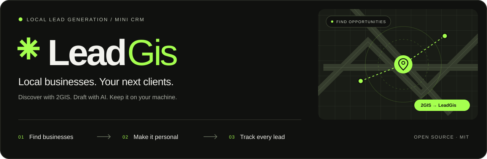
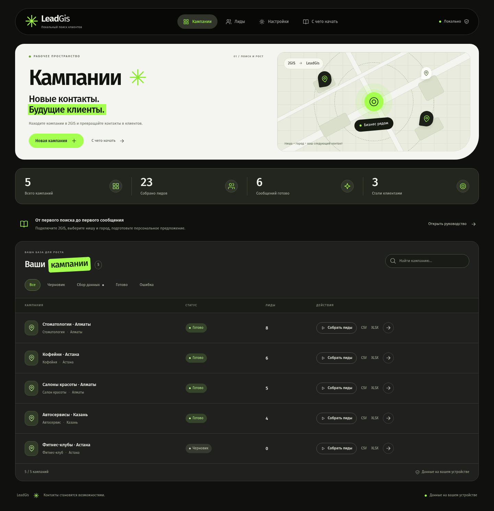
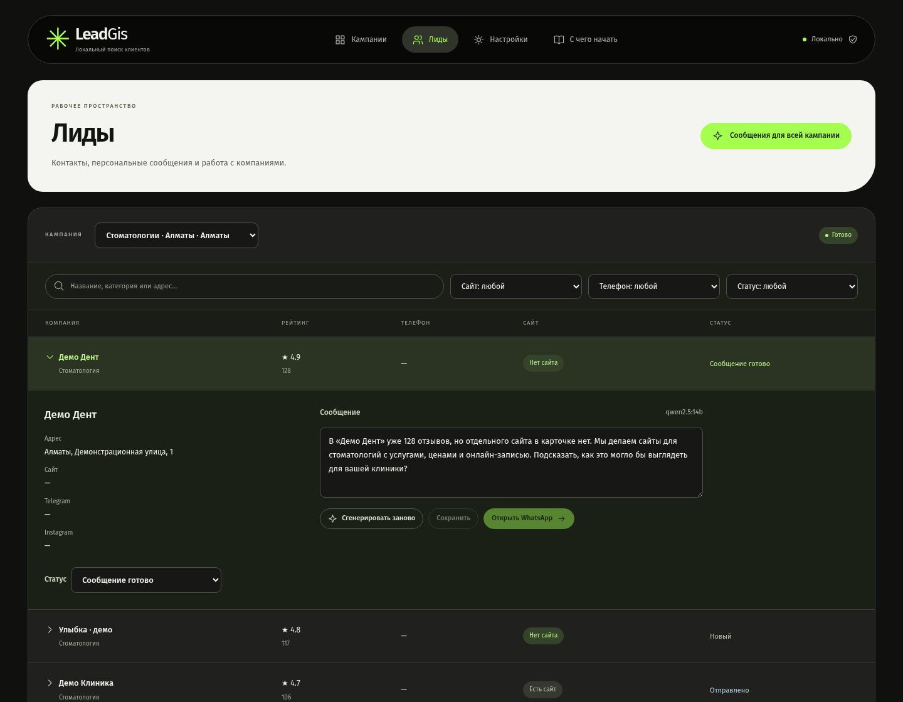

<p align="center">
  <strong>Local Lead Generation &amp; Mini CRM</strong><br>
  2GIS · Ollama · Anthropic · OpenAI-compatible API<br>
  <a href="#быстрый-старт--quickstart">Quickstart</a> ·
  <a href="#скриншоты--screenshots">Screenshots</a> ·
  <a href="docs/GETTING_STARTED.md">Getting started</a> ·
  <a href="LICENSE">MIT License</a>
</p>

**От поиска компаний в 2GIS до персонального сообщения — в одном локальном приложении.**

Полностью локальный, open-source инструмент для лидогенерации: собирает
организации из 2GIS по нише и городу, проверяет наличие сайта и мессенджеров,
генерирует персонализированные сообщения через LLM и показывает всё в
мини-CRM в браузере — без облачного сервера и без телеметрии.

*A fully local, open-source lead-generation tool: collects businesses from
2GIS by niche and city, checks for a website/messengers, drafts a
personalized outreach message via an LLM, and shows everything in a
browser-based mini-CRM — no vendor server, no telemetry.*

Данные и настройки хранятся на вашем компьютере. Для локальной генерации
используйте Ollama; при выборе облачной модели данные для сообщения
передаются выбранному провайдеру.

*Data and settings stay on your machine. Use Ollama for local generation;
cloud models receive the data needed to draft each message.*

## Возможности / Features

- **Поиск компаний** — кампании по нише и городу, сбор организаций через 2GIS Catalog API.
- **Контакты и сайты** — проверка сайта, телефоны и ссылки на мессенджеры.
- **Персональные сообщения** — генерация через Ollama, Anthropic или OpenAI-совместимый API; редактирование перед отправкой.
- **Мини-CRM** — поиск, фильтры и статусы от нового лида до клиента.
- **Отправка и экспорт** — открытие сообщения в WhatsApp для ручной отправки, выгрузка кампании в CSV или XLSX.

*Search businesses by niche and city, check websites, draft personalized
messages, track conversations, and export your leads to CSV or XLSX.*

## Скриншоты / Screenshots

Реальный интерфейс с демонстрационными компаниями и примером сообщения.
Интерфейс приложения — на русском языке.

*The actual interface with demo businesses and a sample message. The app UI is in Russian.*

### Кампании / Campaigns

Обзор кампаний, количество лидов, статусы и экспорт в одном месте.



### Лиды и сообщения / Leads & messages

Фильтры по сайту, телефону и статусу; раскрытая карточка компании с редактором сообщения.



## Быстрый старт / Quickstart

Пошагово: [руководство по началу работы](docs/GETTING_STARTED.md) — установка,
подключение 2GIS и модели, первая кампания, сообщения и экспорт.
В приложении откройте **«С чего начать»** в боковой панели (значок книги на телефоне).

See the [getting-started guide](docs/GETTING_STARTED.md#english-quick-walkthrough)
for an English walkthrough. The in-app guide is under **«С чего начать»**.

### Из исходников (для разработки) / From source (development)

Нужны **Python 3.11+**, **Node.js 18+** и **npm**. Выполняйте команды из корня
репозитория. / Requires **Python 3.11+**, **Node.js 18+** and **npm**. Run from the repository root.

```bash
python3 -m venv .venv
source .venv/bin/activate
pip install -e ".[dev]"
cd frontend && npm install && npm run build && cd ..
leadgis start
```

На Windows используйте `py -m venv .venv` и `.venv\Scripts\Activate.ps1`
в PowerShell. / On Windows, use `py -m venv .venv` and activate with
`.venv\Scripts\Activate.ps1` in PowerShell.

### pipx (для обычной установки) / pipx (regular install)

Соберите фронтенд *до* установки пакета — он собирается в `leadgis/webui/`
и попадает внутрь wheel:

*Build the frontend **before** installing the package — it builds into
`leadgis/webui/` and ships inside the wheel:*

```bash
cd frontend && npm install && npm run build && cd ..
pipx install .
leadgis start
```

В любом случае откроется `http://127.0.0.1:8000`. Конфигурация —
`~/.leadgis/config.toml`, база данных — `~/.leadgis/leadgis.db` (создаются
автоматически при первом запуске). Дальше: Settings → выберите LLM (Ollama
локально не требует ключа) → создайте кампанию → «Собрать лиды» → «Сгенерировать».

*Either way this opens `http://127.0.0.1:8000`. Config and DB are created
automatically on first run. Next: Settings → pick an LLM (Ollama needs no
key) → create a campaign → collect leads → generate messages.*

### Первая кампания / First campaign

1. В **«Настройках»** укажите ключ [2GIS Catalog API](https://dev.2gis.com/), проверьте подключение и сохраните. Доступ и квоты зависят от условий вашего ключа.
2. Выберите модель, опишите свою услугу в **«Ваша услуга»** и сохраните настройки.
3. Создайте кампанию с нишей и городом, затем нажмите **«Собрать лиды»**.
4. Откройте лиды кампании, отберите компании фильтрами и раскройте карточку.
5. Сгенерируйте сообщение, проверьте текст и сохраните правки. Откройте WhatsApp для ручной отправки и обновите статус лида.

*In Settings, save your 2GIS key, model and service offer. Create a campaign,
collect leads, filter the results, then expand a company to generate and
review its message. Open WhatsApp to send it manually and track the lead's status.*

## Разработка / Development

```bash
# backend
ruff check . && ruff format --check . && mypy leadgis && pytest

# frontend dev server (proxies /api to :8000)
cd frontend && npm run dev
```

## Источники данных / Data sources

По умолчанию используется официальный [2GIS Catalog API](https://dev.2gis.com/) —
нужен API-ключ (см. Settings в приложении). Опциональный Playwright-скрапер
(`pip install leadgis[scraper]`) — использовать с осторожностью, см. раздел
"Legal/compliance" ниже.

## Отправка сообщений / Sending

Отправка **полуавтоматическая**: приложение открывает предзаполненную
ссылку `wa.me`/`t.me`, отправляет человек. Массовой автоматической рассылки
в ядре нет и не будет — это осознанное решение (риск блокировки аккаунта +
требования законодательства о рекламе), а не техническое ограничение.

## Legal / compliance

Вы несёте ответственность за соблюдение законодательства о рекламе и
персональных данных в вашей юрисдикции (например, ст. 18 ФЗ "О рекламе" в
РФ — требования о согласии на рекламные рассылки; аналогичные нормы в
РК/РБ), а также условий использования 2GIS API. Скрапер-адаптер (опция)
может нарушать ToS 2GIS — используйте официальный API, когда это возможно.

## License

[MIT](LICENSE)
